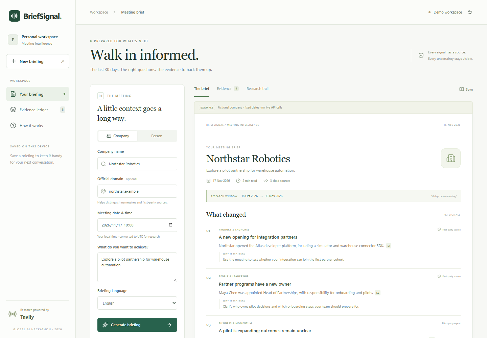
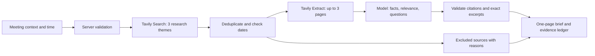

# BriefSignal

[](https://github.com/sutinah12-hash/briefsignal-global-ai-hackathon/actions/workflows/ci.yml)

**Walk in informed.** A source-backed, one-page meeting brief built with Tavily.

Enter a company or person, a meeting time, and your goal. BriefSignal researches the preceding 30 days, connects recent developments to your meeting, and prepares discussion questions. Every finding keeps its source excerpt. Excluded evidence stays visible.

**Global AI Hackathon 2026 · Primary theme: Tavily Research Agent**



## Prototype status

Implemented and locally validated: responsive UI, Tavily Search/Extract adapter, OpenAI-compatible model adapter, streamed progress, date filtering, citation and quote validation, source inspection, browser-local saved briefs, Markdown/JSON export, and one-page A4 printing.

**Live validation is partial:** real Tavily Search and Extract probes passed on 2026-11-16; full pipeline and model validation remain pending a usable model credential. The included Northstar Robotics example is fictional. Its source domains are reserved `.example` domains. Demo mode makes zero external API calls and is visibly labeled; a failed live request never silently becomes a demo. Automated pipeline tests use controlled HTTP responses. They do not establish real-world retrieval accuracy or live model quality. See the [live validation record](docs/LIVE-VALIDATION.md) for observed results and limitations.

Local checks on 2026-11-16: 16 core/pipeline tests, 3 browser scenarios, TypeScript validation, and production build passed. The exported sample brief is one A4 page. See [validation](docs/VALIDATION.md).

## Start locally

Requires **Node.js 24.13+** and npm. Node 24.18 was used for local validation.

```sh
npm ci
npm run dev
```

Open <http://127.0.0.1:5173>. The demo works without accounts, keys, or API credits.

### Enable live research

1. Copy `.dev.vars.example` to `.dev.vars` in the repository root.
2. Set `TAVILY_API_KEY`, `LLM_API_KEY`, `LLM_BASE_URL`, and `LLM_MODEL`.
3. Confirm your provider quotas and billing settings, then restart `npm run dev`.
4. Open **Research connections** to confirm readiness. Replace the fictional example with a real company/person and appropriate official domain, then select **Generate briefing**.

PowerShell:

```powershell
Copy-Item .dev.vars.example .dev.vars
notepad .dev.vars
npm run dev
```

The default model configuration uses an OpenAI-compatible Chat Completions endpoint with JSON-object output. The selected model must support `response_format: {type: "json_object"}`, `temperature`, and `max_tokens`. Other providers can be configured with a compatible base URL and model. Keys are read only on the server; never commit `.dev.vars` or `.env` files. `OPENAI_API_KEY` is accepted as a server-side fallback if `LLM_API_KEY` is unset.

For a network-exposed installation, set `BRIEF_API_TOKEN` and enter it in the Connections dialog. The token is kept in tab memory. The local prototype is not a complete public multi-tenant service: add durable rate limits, user authentication, and per-user quotas before public hosting with funded keys.

### Cost and free credits

Demo and offline tests consume no API credits. A successful live run makes at most three basic Tavily searches, one Extract request containing at most three URLs, and one model call. No automatic retries are implemented. Provider-reported credit and token usage appears in the research trail; unavailable usage is never estimated as zero.

Tavily currently offers a free monthly allowance without a credit card. Eligible ChatGPT Pro subscriptions may offer a separately activated API credit grant. **A subscription is not proof that a grant is active.** Verify the receiving organization, balance, expiry, purchased-credit balance, and recharge settings. BriefSignal cannot enforce provider billing policy or distinguish promotional from paid balance. No paid plan or auto-recharge is required for this prototype.

Official references: [Tavily free-plan limits](https://help.tavily.com/articles/8298987937-billing-credits-usage-limits), [ChatGPT API credits benefit](https://help.openai.com/en/articles/20001626-api-credits-benefit-for-eligible-chatgpt-subscriptions).

A separate free-tier candidate is Gemini 3.1 Flash-Lite. Google's [pricing page](https://ai.google.dev/gemini-api/docs/pricing#gemini-3.1-flash-lite) lists free-tier input/output, and its [OpenAI compatibility guide](https://ai.google.dev/gemini-api/docs/openai) documents the `https://generativelanguage.googleapis.com/v1beta/openai` endpoint. Account eligibility, current quotas and actual BriefSignal output still need verification before use. Do not enable paid billing for a zero-spend demo. Free-tier content may be used to improve Google products; use public or synthetic meeting context.

## Why this is useful

The output is organized around a conversation rather than a collection of search links:

- **What changed:** up to three recent, sourced developments.
- **Why it matters:** explicitly separated AI interpretation tied to the user's goal.
- **What to ask:** concrete, evidence-linked discussion starters.
- **What remains unknown:** missing coverage, unavailable dates, incomplete extraction, and unresolved questions.
- **Evidence ledger:** both accepted and excluded sources, including the exact exclusion reason.

The five mandatory research-agent requirements map to meeting inputs, the time-window filter, the printable brief, clickable citations, and discussion questions. [Selection rationale and official sources (Chinese)](docs/HACKATHON-STRATEGY.zh-CN.md).

## Architecture and implementation



`lib/brief/research.ts` orchestrates bounded provider calls. `lib/brief/core.ts` contains input validation, the deterministic evidence filter, citation checks and Markdown export. `app/api/brief/route.ts` streams NDJSON events to the client. The UI is React/TypeScript running on the Vinext/Vite Cloudflare Worker starter.

**Tavily is essential to live mode:** Search discovers developments and their publication metadata; Extract reads the strongest eligible sources. The model supplies entity relevance, synthesis, interpretation, questions, and gaps. Bifrost is not integrated or claimed in this submission.

### Time and grounding rules

The window starts exactly 30 days before the meeting. Its end is the earlier of meeting time and research time. Future meetings therefore have a partially observed window. Past meeting research filters publication timestamps but does not reconstruct historical versions of webpages.

Missing dates, old/future publications, uncertain boundary-day timestamps, unsafe URLs, empty excerpts, and obvious entity mismatches are excluded. Dates without times on a cutoff day are conservatively excluded. A page that matches the supplied company domain is labeled first-party; that domain is a user hint, not independently verified ownership.

A finding must cite an eligible source and a contiguous quotation found in its retained text. Unknown IDs or missing quotations reject the finding. Questions must refer to accepted findings. **These checks validate provenance, not semantic entailment.** A model can still misinterpret a real quotation, an article can be inaccurate, and a recent publication can discuss an older event. Inspect the evidence before relying on the brief.

### Reliability and privacy

- Requests have timeouts and cancellation; partial search coverage is disclosed.
- No-evidence results remain empty rather than inventing developments.
- Provider errors never trigger a hidden synthetic-data fallback.
- Retrieved content is passed as untrusted data; it cannot execute tools or shell commands.
- Only the configured model endpoint and fixed Tavily endpoints receive server requests. Arbitrary source URLs are passed to Tavily Extract after URL validation, not fetched directly by this server.
- The API checks same-origin requests and supports an optional access token. The concurrency limit is per process/isolate, not a distributed rate limit.
- Meeting context and source text go to configured providers during live research. Browser persistence happens only when the user clicks Save; no server database or analytics is configured.

## Validation

```sh
npm test
npm run typecheck
npm run build
```

Browser verification requires Chrome and a running development server:

```sh
npx playwright test
```

The suite covers UTC offsets, past/future windows, unknown/boundary dates, duplicate URLs, unsafe URLs, official-domain boundaries, fabricated citations, invented quotes, mixed invalid evidence, empty retrieval, provider errors, partial coverage, malformed model JSON, and missing credentials. Browser scenarios cover source dialogs, exclusions, download, save/reload, mobile overflow, configuration guidance, and visible HTTP errors.

These are contract and regression checks, not an independent quality benchmark. Live-case notes should be recorded in `docs/LIVE-VALIDATION.md` after real calls.

## Submission materials

- [56-second product walkthrough](submission/BriefSignal-demo.webm) — real UI interactions, English captions, fictional demo, zero provider calls
- [Pitch deck](submission/BriefSignal-pitch.pptx)
- [Pitch deck PDF](submission/BriefSignal-pitch.pdf)
- [One-page sample](submission/BriefSignal-sample-brief.pdf) — fictional, labeled demonstration
- [Submission text](submission/SUBMISSION.md)
- [Three-minute demo script](submission/DEMO-SCRIPT.zh-CN.md)
- [Validation record](docs/VALIDATION.md)

The official event does not require a deployed application. This repository supplies a reproducible local prototype. Hosting and the final competition submission must be confirmed separately; a public repository is not a submission receipt.

The walkthrough shows source inspection, exclusions, the research trail, local saving, and Markdown export. It is a UI demonstration, not evidence of live-provider validation. To record it again, run the local server, install Playwright's FFmpeg with `PLAYWRIGHT_BROWSERS_PATH` set to `work/playwright-browsers`, then run `node scripts/record-demo.mjs`. Chrome is required; captions are recording overlays and do not change the app.

## Technologies and authorship

TypeScript, React, Vinext, Vite, Cloudflare Workers, Tavily Search/Extract, a configurable OpenAI-compatible model endpoint, Lucide icons, Node's test runner, and Playwright. The local pitch deck uses editable native slide text and screenshots of this prototype.

Core BriefSignal logic, UI, fixtures, tests and submission materials were created for this hackathon on 2026-11-16 with OpenAI Codex assistance. The Sites Vinext starter and its existing support components are reused infrastructure. No competing project's code was copied. AI assistance is disclosed rather than presented as manual authorship. Third-party dependencies retain their own licenses.

MIT license for the original project code; see [LICENSE](LICENSE).
